<div align="center">

# 🚀 Three-Tier Student Portal
### End-to-End DevOps Deployment Project

**Docker · Terraform · AWS EC2 · Jenkins CI/CD · Prometheus · Grafana**

[](https://www.docker.com/)
[](https://aws.amazon.com/ec2/)
[](https://developer.hashicorp.com/terraform)
[](https://www.jenkins.io/)
[](https://prometheus.io/)
[](https://grafana.com/)

</div>

> A hands-on project documenting the journey from a locally containerised three-tier application to an AWS EC2 deployment with an automated Jenkins pipeline and infrastructure monitoring.

**Repository:** [harris2115/three-tier-devops-project](https://github.com/harris2115/three-tier-devops-project)

---

---

## 📌 Table of Contents

- [📖 Project Overview](#-project-overview)
- [🏗️ Application Architecture and Technology Stack](#️-application-architecture-and-technology-stack)
- [💻 Project Environment and Prerequisites](#-project-environment-and-prerequisites)
- [📂 Application Setup](#-application-setup)
- [🐳 Manual Docker Containerisation](#-manual-docker-containerisation)
- [🧪 Local Application Testing](#-local-application-testing)
- [☁️ AWS Infrastructure Provisioning Using Terraform](#️-aws-infrastructure-provisioning-using-terraform)
- [🐙 GitHub Repository Setup](#-github-repository-setup)
- [🖥️ AWS EC2 Environment Setup](#️-aws-ec2-environment-setup)
- [📦 Docker Hub Integration](#-docker-hub-integration)
- [⚙️ Jenkins CI/CD Pipeline Setup](#️-jenkins-cicd-pipeline-setup)
- [🚀 Application Deployment on AWS EC2](#-application-deployment-on-aws-ec2)
- [📊 Monitoring with Prometheus and Grafana](#-monitoring-with-prometheus-and-grafana)
- [✅ Final Testing and Verification](#-final-testing-and-verification)
- [🔐 Security Notes](#-security-notes)
- [👤 Author](#-author)

---

## 📖 Project Overview

This project documents the complete deployment lifecycle of a three-tier Student Portal application. I started by containerising the frontend, backend, and MySQL database on local Ubuntu. After validating the application locally, I provisioned AWS infrastructure with Terraform, deployed the application to an EC2 instance, and automated image delivery and deployment with Jenkins.

Prometheus, Node Exporter, and cAdvisor collect infrastructure and container metrics, while Grafana provides dashboards and alert rules.

**What this project demonstrates**

- Building and running a multi-container application with Docker.
- Connecting application tiers through Docker networking and persistent storage.
- Provisioning AWS networking and compute resources with Terraform.
- Building and publishing versioned Docker images through Jenkins.
- Deploying the application to EC2 using Docker Compose over SSH.
- Monitoring host and container health with Prometheus and Grafana.

### ⚙️ CI/CD Workflow

The Jenkins pipeline automates the build, image publishing, and deployment of the application to AWS EC2.

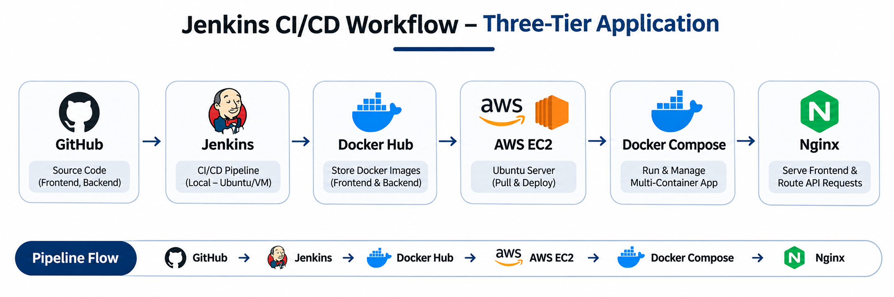

### 🎯 Objectives

-   Containerise the application using Docker.
-   Manage application containers and persistent storage.
-   Provision AWS infrastructure using Terraform.
-   Automate build and deployment using Jenkins.
-   Monitor infrastructure and containers using Prometheus and Grafana.

## 🧭 Project Walkthrough

Follow the sections in order to reproduce the project:

1. Prepare the application source code.
2. Build and test the three containers locally.
3. Provision the AWS VPC and EC2 host with Terraform.
4. Push the project to GitHub and prepare Docker Hub repositories.
5. Install and configure Docker on EC2.
6. Configure Jenkins credentials and the pipeline on local Ubuntu.
7. Deploy the versioned images to EC2.
8. Configure Prometheus and Grafana, then verify the deployment.

**Command context:** Windows commands run on the local workstation. Docker and monitoring commands run on the Ubuntu VM or EC2 host, as identified in each section.

---

## 🏗️ Application Architecture and Technology Stack

### Three-Tier Application Architecture

The application uses the following three-tier architecture:

```text
                    ┌──────────────────┐
                    │      Browser     │
                    └────────┬─────────┘
                             │
                             │ HTTP :80
                             ▼
                  ┌─────────────────────┐
                  │      FRONTEND       │
                  │   React + Nginx     │
                  │    Container :80    │
                  └──────────┬──────────┘
                             │
                             │ API :3500
                             ▼
                  ┌─────────────────────┐
                  │       BACKEND       │
                  │     Node.js API     │
                  │   Container :3500   │
                  └──────────┬──────────┘
                             │
                             │ MySQL :3306
                             ▼
                  ┌─────────────────────┐
                  │      DATABASE      │
                  │       MySQL        │
                  │   Container :3306  │
                  └─────────────────────┘
```

### 🛠️ Technology Stack

| Category | Technology |
|---|---|
| Frontend | React |
| Web server | Nginx |
| Backend | Node.js |
| Database | MySQL |
| Containerisation | Docker |
| Container management | Docker Compose |
| Cloud platform | AWS EC2 |
| Infrastructure as Code | Terraform |
| CI/CD | Jenkins |
| Container registry | Docker Hub |
| Monitoring | Prometheus, Node Exporter, cAdvisor |
| Dashboards and alerting | Grafana |
| Version control | Git |
| Source code hosting | GitHub |

## 💻 Project Environment and Prerequisites

The initial application setup and manual containerisation were performed using Ubuntu inside VirtualBox. AWS infrastructure provisioning was performed from Windows using AWS CLI and Terraform.

| Component | Configuration |
|---|---|
| Operating system | Ubuntu 26.04.1 LTS |
| Virtualisation | Oracle VirtualBox |
| Allocated RAM | 6 GB |
| Allocated CPU | 2 cores |

**Tools used:** Git, Docker Engine, Docker Compose, Terraform, AWS CLI, AWS EC2, Jenkins, Docker Hub, Prometheus, Node Exporter, cAdvisor, Grafana, and GitHub.

**Where each tool runs:** Terraform and AWS CLI run on the Windows machine. Jenkins runs on local Ubuntu inside VirtualBox. The application and monitoring containers run on AWS EC2.

## 📂 Application Setup

### 🔗 Source Code

The initial three-tier Student Portal application was obtained from:

[Three-Tier Student Portal Source
Repository](https://github.com/Neha-V-M/-Containerizing-a-Three-Tier-Student-Teacher-Application)

Clone the application:

```bash
mkdir /3tier_project
cd /3tier_project
git clone https://github.com/Neha-V-M/-Containerizing-a-Three-Tier-Student-Teacher-Application.git
```

### 📂 Application Structure

```text
three-tier-application/
├── frontend/
│   ├── Dockerfile
│   ├── nginx.conf
│   ├── package.json
│   └── package-lock.json
├── backend/
│   ├── Dockerfile
│   ├── .dockerignore
│   ├── package.json
│   ├── package-lock.json
│   └── .env.example
└── database/
    └── Dockerfile
```

Each component has its own Dockerfile to build an individual Docker
image.

## 🐳 Manual Docker Containerisation

### 🔄 Build Order — Bottom to Top

Containers are built and started in this order:

```text
Database → Backend → Frontend
```

The backend depends on the database being available, and the frontend depends on the backend being available. Starting in dependency order avoids connection errors that would occur if a dependent service started before what it needs.

The first containerisation stage was performed manually on local Ubuntu.
Individual Docker images and containers were created for MySQL, the
Node.js backend, and the React frontend.

### Prepare the Docker network and persistent volume

### Why a Custom Network Is Needed

With three separate containers (DB, backend, frontend) that must talk to each other, a shared custom network is created so they can all communicate. This also acts as a network-isolation best practice — containers on other, unrelated networks won't be able to reach these containers.

#### 1. Create a custom Docker network

```bash
docker network create three-tier-network
docker network ls
```

#### 2. Create a persistent Docker volume

Ensures MySQL's data physically persists on the local machine, outside the container's own ephemeral storage — so if the container is deleted, the data survives and a new container can pick up right where the old one left off.

```bash
docker volume create mysql-data
docker volume ls
```

### Step 1 — Build and run the MySQL database

The MySQL image was built using the database Dockerfile:

```dockerfile
FROM mysql:8.0.40

ENV MYSQL_ROOT_PASSWORD=<your-password>
ENV MYSQL_DATABASE=school

EXPOSE 3306

VOLUME /var/lib/mysql

CMD ["mysqld"]
```

Build and run:

```bash
docker build -t mysql-image .

docker run -d \
  -p 3306:3306 \
  --network three-tier-network \
  -v mysql-data:/var/lib/mysql \
  --name mysql-container \
  mysql-image
```

### Step 2 — Build and run the Node.js backend

Backend Dockerfile:

```dockerfile
FROM node:20-alpine AS build

WORKDIR /app
COPY package*.json .
RUN npm ci --only=production
RUN npm cache clean --force
COPY . .

FROM node:20-alpine

RUN addgroup js && adduser -G js -S nodejs
WORKDIR /app
COPY --from=build /app /app
USER nodejs

EXPOSE 3500
CMD ["node", "server.js"]
```

Build and run:

```bash
docker build -t backend-image .

docker run -d \
  -p 3500:3500 \
  --network three-tier-network \
  -e host=mysql-container \
  -e user=appuser \
  -e password=apppassword \
  -e database=school \
  --name backend-container \
  backend-image
```

Replace example credentials with secure values for your environment. Do
not commit real passwords to GitHub.

### Step 3 — Build and run the React frontend

Frontend Dockerfile:

```dockerfile
FROM node:20-alpine AS build

WORKDIR /app

ARG REACT_APP_API_BASE_URL
ENV REACT_APP_API_BASE_URL=$REACT_APP_API_BASE_URL

COPY package*.json .
RUN npm install

COPY . .
RUN npm run build

FROM nginx:alpine

COPY --from=build /app/build /usr/share/nginx/html
COPY nginx.conf /etc/nginx/conf.d/default.conf

EXPOSE 80
CMD ["nginx", "-g", "daemon off;"]
```

Build and run:

```bash
docker build -t frontend-image \
  --build-arg REACT_APP_API_BASE_URL=http://localhost:3500 .

docker run -d \
  -p 8081:80 \
  --network three-tier-network \
  --name frontend-container \
  frontend-image
```

Host port `8081` was used because other local services were using ports
`80` and `8080`. The frontend container continued to use port `80`.

### Step 4 — Configure host Nginx as a reverse proxy

Nginx was also configured on the Ubuntu host to forward requests to the
frontend and backend containers.

```nginx
server {
    listen 80;
    server_name _;

    location / {
        proxy_pass http://127.0.0.1:8081;

        proxy_set_header Host $host;
        proxy_set_header X-Real-IP $remote_addr;
        proxy_set_header X-Forwarded-For $proxy_add_x_forwarded_for;
        proxy_set_header X-Forwarded-Proto $scheme;
    }

    location /api/ {
        proxy_pass http://127.0.0.1:3500/;

        proxy_set_header Host $host;
        proxy_set_header X-Real-IP $remote_addr;
        proxy_set_header X-Forwarded-For $proxy_add_x_forwarded_for;
        proxy_set_header X-Forwarded-Proto $scheme;
    }
}
```

## 🧪 Local Application Testing

The frontend was accessed locally at:

```text
http://localhost:8081
```

The Student Portal frontend and student and teacher sections were
tested. Student records were added through the frontend, and
communication with the backend and database was verified. After
successful local testing, the project progressed to AWS deployment.

## ☁️ AWS Infrastructure Provisioning with Terraform

This stage provisions the AWS network and EC2 host used for the application deployment. Terraform and AWS CLI are installed on the **local Windows machine**; Terraform communicates with AWS through the credentials configured by AWS CLI.

> **Credential safety:** Never paste AWS access keys or secret keys into this README, Terraform files, screenshots, or GitHub. The credentials in the original setup screenshot have been redacted in this documentation. If any real access key or secret key was previously committed or shared, deactivate it in IAM and create a replacement immediately.

### 1. Install the local prerequisites

Complete both installations on the Windows machine before creating the infrastructure.

#### Install AWS CLI

1. Open the [official AWS CLI installation guide](https://docs.aws.amazon.com/cli/latest/userguide/getting-started-install.html).
2. Download the Windows **MSI installer**.
3. Run the installer and complete the setup.
4. Open Command Prompt and verify:

```cmd
aws --version
```

#### Install Terraform

1. Open the [official HashiCorp Terraform installation guide](https://developer.hashicorp.com/terraform/install).
2. Download the Windows package for your system.
3. Add the Terraform executable to your system `PATH` if required.
4. Open a new Command Prompt and verify:

```cmd
terraform --version
```

### 2. Configure AWS CLI credentials

Create an IAM identity with permissions appropriate for the resources Terraform needs to manage. Use a dedicated IAM user or role; do not use the AWS root account for routine work.

In Command Prompt, run:

```cmd
aws configure
```

Enter your access key, secret access key, default region, and output format when prompted. This project uses `ap-southeast-2`.

Verify that the CLI can identify the configured identity:

```cmd
aws sts get-caller-identity
```

The command should return the AWS account and caller identity. Never copy credential values into the README.

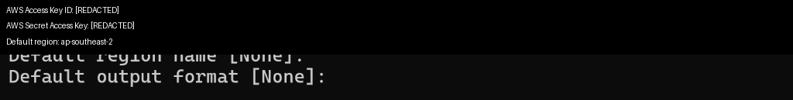

### 3. Prepare the Terraform working directory

Create or open the project directory that will contain the Terraform configuration:

```cmd
cd %USERPROFILE%\Desktop\3tier_Project
```

Keep the Terraform configuration files together. Terraform automatically loads all `.tf` files in the same working directory.

```text
3tier_Project/
├── 3tier.tf       # AWS provider and EC2 instance
├── network.tf     # VPC, subnets, gateway, route table and security group
├── key.tf         # EC2 key-pair registration
└── .gitignore
```

Do not place AWS credentials or your SSH private key in this directory. The public SSH key (`.pub`) can be used by Terraform to register the EC2 key pair.

### 4. Create or prepare an SSH key pair

If you already have a matching SSH key pair, use it. Otherwise, generate one from PowerShell:

```powershell
ssh-keygen -t ed25519 -f "$env:USERPROFILE\.ssh\three_tier_key"
```

This creates:

- `three_tier_key` — the **private key**. Keep it secure and never upload it.
- `three_tier_key.pub` — the **public key**. Terraform registers this key with AWS.

For the configuration below, copy the public key into the Terraform working directory, or update the `file()` path to point to the actual `.pub` file.

Create `key.tf`:

```cmd
notepad key.tf
```

Add:

```hcl
# Register the public SSH key with AWS
resource "aws_key_pair" "three_tier_key" {
  key_name   = "three-tier-key"
  public_key = file("${path.module}/three_tier_key.pub")
}
```

The public key file must exist at the specified path before Terraform runs.

### 5. Define the EC2 instance in `3tier.tf`

Create the file:

```cmd
notepad 3tier.tf
```

Add the AWS provider and EC2 instance configuration:

```hcl
# AWS PROVIDER CONFIGURATION

terraform {
  required_providers {
    aws = {
      source  = "hashicorp/aws"
      version = "~> 6.0"
    }
  }
}

provider "aws" {
  region = "ap-southeast-2"
}

# CREATE EC2 INSTANCE

resource "aws_instance" "three_tier_server" {
  ami           = "ami-0dd60a46ecc6eac16"
  instance_type = "t2.medium"

  # Associate SSH Key Pair
  key_name = aws_key_pair.three_tier_key.key_name

  # Associate EC2 with Public Subnet
  subnet_id = aws_subnet.public_subnet.id

  # Associate Frontend Security Group
  vpc_security_group_ids = [
    aws_security_group.frontend_sg.id
  ]

  # Enable Public IP
  associate_public_ip_address = true

  tags = {
    Name = "three_tier_server"
  }
}
```

**Important:** This EC2 resource references `aws_subnet.public_subnet` and `aws_security_group.frontend_sg`, which are defined in `network.tf`. Create `network.tf` before running the final Terraform plan or apply. Terraform must be able to load all referenced resources in the working directory.

The AMI ID is region-specific. Confirm that it is available in `ap-southeast-2` and compatible with the selected instance type.

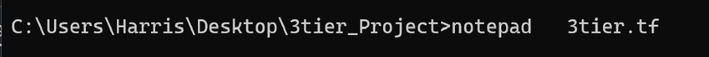

### 6. Define the VPC and networking resources in `network.tf`

Create the network configuration file:

```cmd
notepad network.tf
```

#### A. Create the VPC

```hcl
resource "aws_vpc" "three_tier_vpc" {
  cidr_block           = "10.0.0.0/16"
  enable_dns_support   = true
  enable_dns_hostnames = true

  tags = {
    Name = "three-tier-vpc"
  }
}
```

The VPC provides an isolated network for the project resources.

#### B. Create public and private subnets

```hcl
resource "aws_subnet" "public_subnet" {
  vpc_id                  = aws_vpc.three_tier_vpc.id
  cidr_block              = "10.0.1.0/24"
  availability_zone       = "ap-southeast-2a"
  map_public_ip_on_launch = true

  tags = {
    Name = "three-tier-public-subnet"
  }
}

resource "aws_subnet" "private_subnet" {
  vpc_id            = aws_vpc.three_tier_vpc.id
  cidr_block        = "10.0.2.0/24"
  availability_zone = "ap-southeast-2a"

  tags = {
    Name = "three-tier-private-subnet"
  }
}
```

The EC2 instance is placed in the public subnet. The private subnet is created as part of the VPC layout; this walkthrough does not claim that a database instance was deployed there.

#### C. Create the internet gateway

```hcl
resource "aws_internet_gateway" "three_tier_igw" {
  vpc_id = aws_vpc.three_tier_vpc.id

  tags = {
    Name = "three-tier-igw"
  }
}
```

#### D. Create and associate the public route table

```hcl
resource "aws_route_table" "public_route_table" {
  vpc_id = aws_vpc.three_tier_vpc.id

  route {
    cidr_block = "0.0.0.0/0"
    gateway_id = aws_internet_gateway.three_tier_igw.id
  }

  tags = {
    Name = "three-tier-public-rt"
  }
}

resource "aws_route_table_association" "public_route_association" {
  subnet_id      = aws_subnet.public_subnet.id
  route_table_id = aws_route_table.public_route_table.id
}
```

The default route sends internet-bound traffic from the public subnet through the internet gateway.

#### E. Create the frontend security group

```hcl
resource "aws_security_group" "frontend_sg" {
  name        = "frontend-sg"
  description = "Allow HTTP, HTTPS and restricted SSH"
  vpc_id      = aws_vpc.three_tier_vpc.id

  ingress {
    description = "HTTP"
    from_port   = 80
    to_port     = 80
    protocol    = "tcp"
    cidr_blocks = ["0.0.0.0/0"]
  }

  ingress {
    description = "HTTPS"
    from_port   = 443
    to_port     = 443
    protocol    = "tcp"
    cidr_blocks = ["0.0.0.0/0"]
  }

  ingress {
    description = "SSH - replace with your own public IP"
    from_port   = 22
    to_port     = 22
    protocol    = "tcp"
    cidr_blocks = ["YOUR_PUBLIC_IP/32"]
  }

  egress {
    from_port   = 0
    to_port     = 0
    protocol    = "-1"
    cidr_blocks = ["0.0.0.0/0"]
  }

  tags = {
    Name = "frontend-sg"
  }
}
```

Replace `YOUR_PUBLIC_IP/32` with your current public IP in CIDR notation before applying. Avoid opening SSH (`22`) to `0.0.0.0/0`.

#### F. Backend security group — configuration note

The earlier backend security-group example allowed port `3000`, but this application backend listens on port **3500**. Also, the EC2 resource above attaches only `frontend_sg`.

In the current single-EC2 Docker deployment, frontend-to-backend and backend-to-MySQL communication take place over the Docker network. The backend port does not need to be opened to the public internet. If you later move the backend to a separate EC2 instance, update the rule to the actual backend port (`3500`) and restrict its source to the frontend tier. Do not expose MySQL publicly.

### 7. Review the AWS network layout

The Terraform configuration creates one VPC with a public subnet and a private subnet. The EC2 instance is deployed in the **public subnet** and runs the complete application stack as Docker containers. The private subnet is currently reserved for future private-tier resources; it does not host a separate backend or database instance in the current deployment.

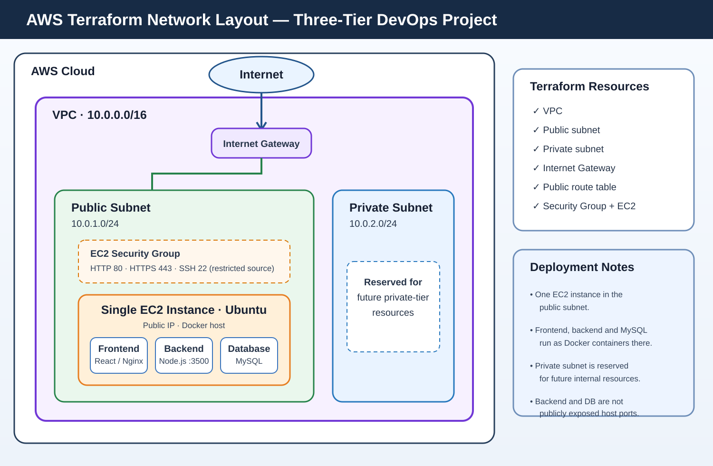

**How to read this layout:**

- Internet traffic reaches the public subnet through the Internet Gateway and the public route table.
- The EC2 security group allows inbound HTTP (80), HTTPS (443), and SSH (22), with SSH restricted to the configured administrator IP.
- The frontend, backend, and MySQL run as containers on the **same EC2 host**. The backend and database communicate over the Docker network and are not exposed as public EC2 host ports.
- The private subnet exists in the VPC configuration but is not currently attached to a separate application instance.

This reflects the deployed single-EC2 architecture rather than a three-instance design.

### 8. Initialise, format, validate, and plan

Once `3tier.tf`, `network.tf`, `key.tf`, and the public key file are all in the same working directory, run these commands from that directory.

Initialise the AWS provider:

```cmd
terraform init
```

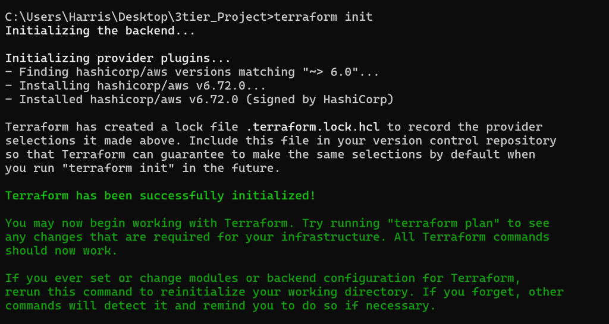

Format the configuration:

```cmd
terraform fmt
```

Validate the configuration:

```cmd
terraform validate
```

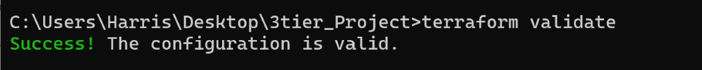

Generate an execution plan:

```cmd
terraform plan
```

Review the proposed resources carefully. The plan should include the VPC, subnets, internet gateway, route table association, security group, key pair, and EC2 instance.

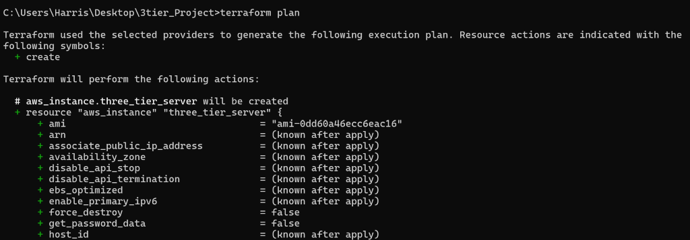

### 9. Apply the Terraform configuration

Apply the saved plan:

```cmd
terraform apply
```

Review the output and confirm the operation when Terraform asks for approval.

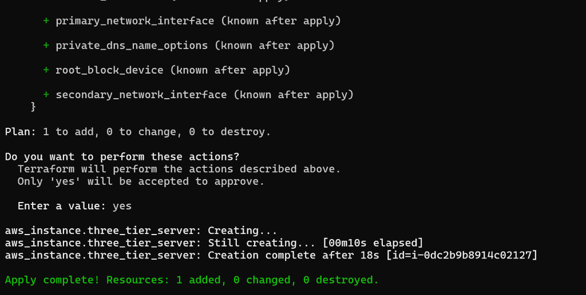

### 10. Verify the provisioned resources

List the resources tracked in Terraform state:

```cmd
terraform state list
```

Then verify the EC2 instance, VPC, subnet, route table, internet gateway, and security group in the AWS Management Console.

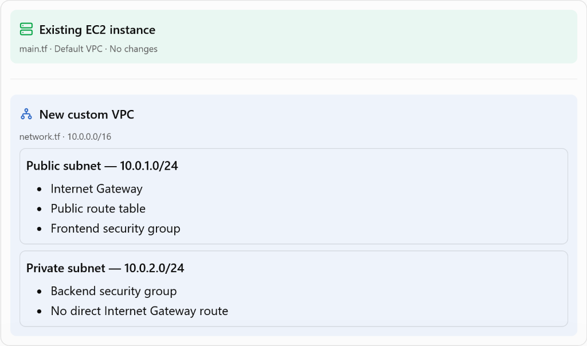

### 11. Connect to EC2

Retrieve the instance's public IPv4 address from the EC2 console, then connect from PowerShell:

```powershell
ssh -i "$env:USERPROFILE\.ssh\three_tier_key" ubuntu@<EC2_PUBLIC_IP>
```

Replace `<EC2_PUBLIC_IP>` with the actual public IPv4 address. The private key must match the public key registered by `key.tf`.

After connecting, update Ubuntu:

```bash
sudo apt update
sudo apt upgrade -y
```

**Terraform state and cleanup:** Keep `terraform.tfstate`, `tfplan`, private keys, and credential files out of public Git repositories. Use `.gitignore` to exclude local state and sensitive files. Before destroying infrastructure, review `terraform plan -destroy` carefully; do not run it against resources you still need.

## 🐙 GitHub Repository Setup

Git was used to initialise the project repository and push the
application code to GitHub.

### 8.1 Initialise Git and configure the remote

```bash
cd /3tier_project
git init
git branch -M main

git remote add origin https://github.com/harris2115/three-tier-devops-project.git
git remote -v
```

### 8.2 Configure `.gitignore`

```text
node_modules/
.env
.env.*
!.env.example
dist/
build/
.DS_Store
```

### 8.3 Commit and push

Configure Git identity:

```bash
git config --global user.name "YOUR_NAME"
git config --global user.email "YOUR_GITHUB_EMAIL"
```

Add and commit:

```bash
git add .
git status
git commit -m "Initial commit: three_tier_project"
git push -u origin main
```

A GitHub Personal Access Token was used for HTTPS authentication instead
of a GitHub account password. Keep the token private.

## 🖥️ AWS EC2 Environment Setup

After creating the EC2 instance, the required deployment tools were
installed on the Ubuntu server.

### 9.1 Update the instance

```bash
sudo apt update
sudo apt upgrade -y
```

### 9.2 Install and verify Docker

Docker Engine was installed using the official Docker installation
instructions for Ubuntu.

```bash
docker --version
sudo systemctl status docker
```

### 9.3 Install and verify Docker Compose

The Docker Compose plugin was installed to manage the multi-container
production application.

```bash
docker compose version
```

### 9.4 Install and verify Git

```bash
sudo apt install git -y
git --version
```

Jenkins was installed on local Ubuntu inside VirtualBox, not on EC2.

## 📦 Docker Hub Integration

Docker Hub was used as the container image registry between Jenkins and
AWS EC2.

### 10.1 Docker Hub repositories

Two repositories were created:

- `harris2115/three-tier-frontend`
- `harris2115/three-tier-backend`

### 10.2 Docker Hub authentication

A Docker Hub access token was created with the required permissions.
Authentication was performed using:

```bash
docker login -u harris2115
```

The access token was supplied securely when prompted. The frontend and
backend images were subsequently pushed to Docker Hub through the
Jenkins pipeline.

## ⚙️ Jenkins CI/CD Pipeline Setup

The CI/CD pipeline automates the process of taking application code from GitHub, building Docker images, publishing those images to Docker Hub, and deploying the updated application to AWS EC2.

In this project, **Jenkins runs locally on Ubuntu inside VirtualBox**. It connects to AWS EC2 over SSH for deployment; Jenkins is not installed on the EC2 instance.

### 11.1 Understand the CI/CD workflow

The pipeline follows this sequence:

```text
Developer pushes code to GitHub
              |
              v
       Jenkins (Local Ubuntu)
              |
              v
     Checkout source code
              |
              v
   Build frontend and backend
              |
              v
       Push images to
          Docker Hub
              |
              v
     SSH connection to EC2
              |
              v
  Pull images and deploy using
   docker-compose.prod.yaml
              |
              v
       Application health check
```

Each stage is explained below, including what it does and how it fits into the deployment process.

### 11.2 Prepare the local Jenkins environment

Jenkins was installed on the Ubuntu virtual machine running in VirtualBox. Java was installed first because Jenkins requires a Java runtime.

Update Ubuntu and install Java:

```bash
sudo apt update
sudo apt install fontconfig openjdk-21-jre
```

Verify the Java installation:

```bash
java --version
```

Install Jenkins LTS by following the official Jenkins installation guide:

https://www.jenkins.io/doc/book/installing/linux/

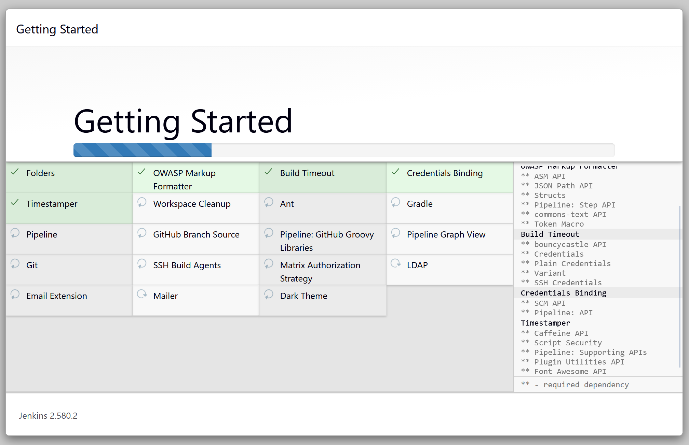

After installation, open Jenkins in the Ubuntu browser:

```text
http://localhost:8080
```

Complete the initial setup wizard and sign in to the Jenkins dashboard.

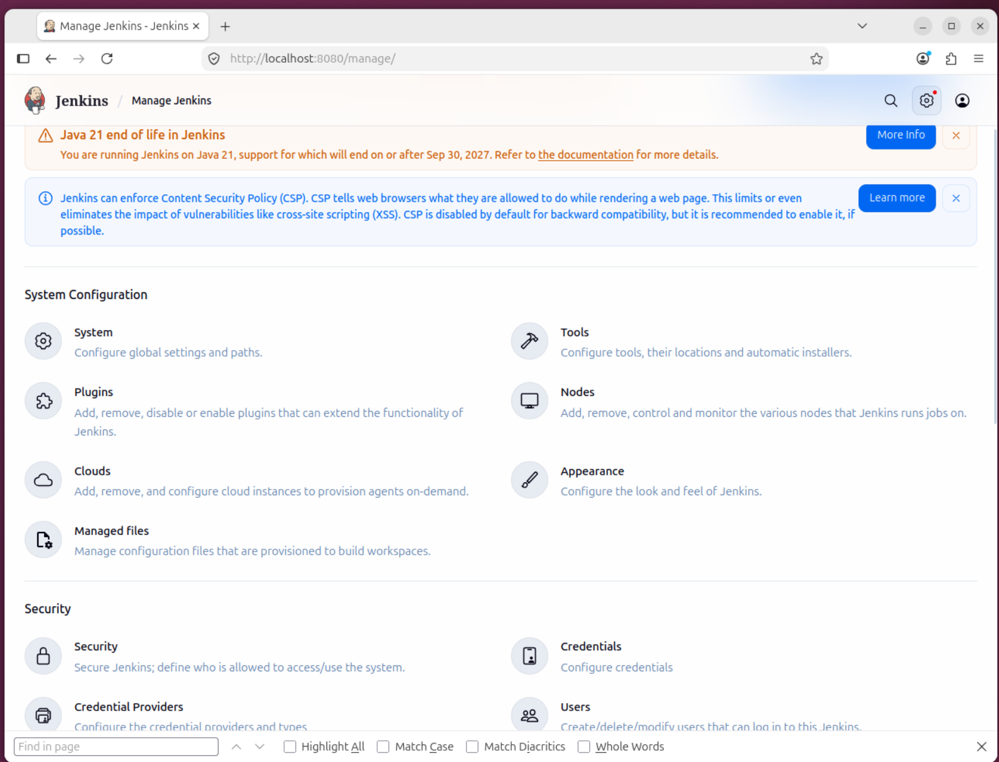

**Important:** Jenkins uses port `8080` on the local Ubuntu machine. In this project, the application frontend is mapped to a different host port during local testing, so it does not conflict with Jenkins.

### 11.3 Install the required Jenkins plugins

Jenkins uses plugins to connect to Git, run pipeline jobs, manage credentials, and display build stages.

Open:

**Manage Jenkins → Plugins → Available plugins**

Install the plugins used in this project:

| Plugin | Why it is needed |
|---|---|
| Git | Allows Jenkins to retrieve the project source code from GitHub |
| Pipeline | Provides Jenkins Pipeline job support |
| Docker Pipeline | Adds Docker-related pipeline integration |
| SSH Agent | Supports SSH-based connections and authentication |
| Credentials Binding | Makes stored credentials available securely during pipeline execution |
| Pipeline Stage View | Displays pipeline stages and their execution status |

After installing the plugins, restart Jenkins if the plugin manager requests it.

### 11.4 Add Docker Hub and EC2 credentials to Jenkins

The pipeline needs two sets of credentials:

1. Docker Hub credentials so Jenkins can authenticate and push images.
2. An SSH private key so Jenkins can connect to the Ubuntu EC2 instance.

Rather than writing passwords, tokens, or private keys directly in the `Jenkinsfile`, store them in Jenkins Credentials.

Open:

**Manage Jenkins → Credentials → System → Global credentials**

Choose **Add Credentials**.

#### A. Add Docker Hub credentials

Create a credential with these settings:

| Field | Value |
|---|---|
| Kind | Username with password |
| Username | Your Docker Hub username |
| Password | Docker Hub access token |
| ID | `dockerhub-creds` |
| Description | Docker Hub authentication |

The credential ID must match `dockerhub-creds`, because the `Jenkinsfile` refers to this ID when logging in to Docker Hub.

The pipeline uses the stored token with `docker login --password-stdin`. This avoids placing the token directly in the command or source code.

#### B. Add the EC2 SSH private key

Create another credential:

| Field | Value |
|---|---|
| Kind | SSH Username with private key |
| Username | `ubuntu` |
| Private Key | Paste the private key corresponding to the EC2 key pair |
| ID | `ec2-ssh-key` |
| Description | SSH access to AWS EC2 |

The credential ID must be `ec2-ssh-key`, as this is the ID referenced by the pipeline.

**Security reminder:** Never commit the EC2 private key or Docker Hub access token to GitHub. Keep them in Jenkins Credentials.

### 11.5 Understand the Jenkinsfile

The `Jenkinsfile` is stored in the root of the GitHub project repository. It defines the stages Jenkins executes during a pipeline run.

The pipeline uses:

- `BUILD_NUMBER` to create a unique image tag for each Jenkins build.
- `dockerhub-creds` to authenticate with Docker Hub.
- `ec2-ssh-key` to authenticate to the EC2 instance.
- `docker-compose.prod.yaml` to deploy the production containers on EC2.

The main stages in the project are:

#### Stage 1 — Checkout

```groovy
stage('Checkout') {
    steps {
        checkout scm
    }
}
```

Jenkins checks out the source code from the GitHub repository configured in the pipeline job. This makes the frontend, backend, Dockerfiles, and deployment configuration available to the following stages.

#### Stage 2 — Build Docker Images

```groovy
stage('Build Docker Images') {
    steps {
        sh '''
            docker build --pull \
              -t harris2115/three-tier-backend:${IMAGE_TAG} \
              -t harris2115/three-tier-backend:latest \
              ./backend

            docker build --pull \
              --build-arg REACT_APP_API_BASE_URL= \
              -t harris2115/three-tier-frontend:${IMAGE_TAG} \
              -t harris2115/three-tier-frontend:latest \
              ./frontend
        '''
    }
}
```

Jenkins builds the backend and frontend images from their respective directories.

Each image receives two tags:

- A build-specific tag, using the Jenkins build number.
- The `latest` tag, which points to the most recently published image.

For example, a build-specific tag could look like:

```text
harris2115/three-tier-backend:7
harris2115/three-tier-frontend:7
```

The build-specific tag makes it possible to identify which Jenkins build produced an image. The `latest` tag provides a convenient reference to the most recently published image.

#### Stage 3 — Push Images to Docker Hub

Jenkins retrieves the `dockerhub-creds` credential and uses it to log in to Docker Hub.

It then pushes both the build-specific and `latest` tags for the frontend and backend images.

After pushing the images, the pipeline logs out of Docker Hub.

The published images are available in the Docker Hub repositories:

- `harris2115/three-tier-frontend`
- `harris2115/three-tier-backend`

#### Stage 4 — Deploy to AWS EC2

Jenkins retrieves the `ec2-ssh-key` credential and establishes an SSH connection to the Ubuntu EC2 instance.

The remote deployment commands perform these actions:

1. Move to the application deployment directory on EC2.
2. Update the `IMAGE_TAG` value in the EC2 `.env` file to match the current Jenkins build.
3. Pull the matching frontend and backend images from Docker Hub.
4. Run Docker Compose using `docker-compose.prod.yaml`.
5. Display the status of the deployed containers.

The deployment uses:

```bash
docker compose --env-file .env \
  -f docker-compose.prod.yaml pull

docker compose --env-file .env \
  -f docker-compose.prod.yaml up -d --remove-orphans

docker compose --env-file .env \
  -f docker-compose.prod.yaml ps
```

The production Compose configuration uses the build-specific `IMAGE_TAG` to select the images. It also starts the database, backend, and frontend services in the required dependency order.

**Deployment note:** The EC2 host address is configured as a deployment target in the pipeline. Do not publish private keys, passwords, access tokens, or other secrets in the README or screenshots.

#### Stage 5 — Application Health Check

After deployment, the pipeline checks the application endpoint:

```text
http://localhost/health
```

The health check retries up to 12 times, waiting 5 seconds between attempts. If the endpoint responds successfully, the pipeline reports that the application health check succeeded. If all attempts fail, the deployment stage exits with an error.

This check helps confirm that the application is responding after the new containers have been started.

### 11.6 Create the Jenkins pipeline job

Now that the credentials and `Jenkinsfile` are ready, create a pipeline job.

1. Open the Jenkins dashboard.
2. Select **New Item**.
3. Enter the job name:

   ```text
   three-tier-cicd-pipeline
   ```

4. Select **Pipeline**.
5. Click **OK**.
6. In the job configuration, find the **Pipeline** section.
7. For **Definition**, select **Pipeline script from SCM**.
8. For **SCM**, select **Git**.
9. Enter the GitHub repository URL:

   ```text
   https://github.com/harris2115/three-tier-devops-project.git
   ```

10. Select the branch that contains your project `Jenkinsfile`.
11. Set **Script Path** to:

    ```text
    Jenkinsfile
    ```

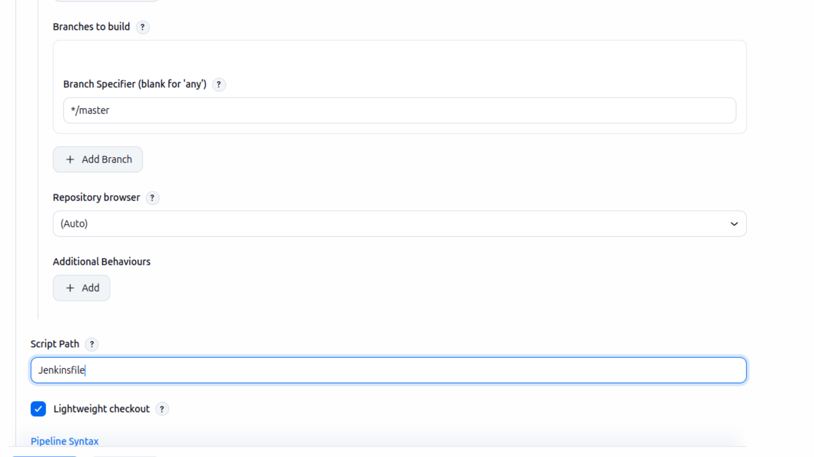

12. Save the job configuration.

Jenkins will now retrieve the pipeline definition from the repository when the job runs.

### 11.7 Run the pipeline

Open the `three-tier-cicd-pipeline` job and select **Build Now**.

To follow the execution:

1. Open the build number that appears in **Build History**.
2. Select **Console Output** to see the detailed command output.
3. Open **Pipeline Stage View** to see the status of each stage.
4. Check that checkout, image build, Docker Hub push, EC2 deployment, and the health check complete successfully.

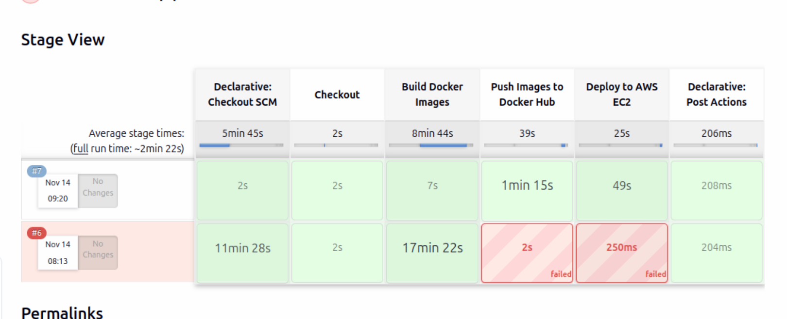

If a stage fails, open that stage's console output and review the error before running the pipeline again.

### 11.8 Verify the successful deployment

The pipeline was executed successfully, and build **#7** completed the deployment workflow.

The final verification should confirm:

- The Jenkins pipeline build completed successfully.
- The frontend and backend images were pushed to their Docker Hub repositories.
- The EC2 instance pulled the expected image tags.
- Docker Compose reports the production containers as running.
- The application health check succeeds.

The Jenkins job used for this project is:

```text
three-tier-cicd-pipeline
```


## 🚀 Application Deployment on AWS EC2

The production application was deployed on EC2 using Docker Compose. Jenkins performs these deployment commands over SSH in the automated workflow; this section documents the deployment layout and the equivalent commands for manual verification or recovery.

### 12.1 Deployment directory

The deployment files were maintained in:

```text
/home/ubuntu/three-tier-app
```

The production configuration file was `docker-compose.prod.yaml`.

### 12.2 Production Compose services

The production Compose configuration contains three services:

-   **db:** MySQL database with persistent storage and a health check.
-   **backend:** Node.js application image pulled from Docker Hub.
-   **frontend:** React application served through Nginx and exposed on
    port `80`.

The backend communicates with MySQL through the internal Docker network.
The database and backend do not need to expose their application ports
publicly.

### 12.3 Environment configuration

The EC2 deployment uses an `.env` file for environment-specific
configuration, including the MySQL root password and image tag.

Example structure:

```dotenv
MYSQL_ROOT_PASSWORD=<your-secure-password>
IMAGE_TAG=latest
```

Keep the actual password private and exclude the `.env` file from
GitHub.

### 12.4 Deploy the application

Pull the Docker images:

```bash
docker compose -f docker-compose.prod.yaml pull
```

Start the application:

```bash
docker compose -f docker-compose.prod.yaml up -d
```

### 12.5 Verify containers and logs

```bash
docker ps -a
docker compose -f docker-compose.prod.yaml ps
docker compose -f docker-compose.prod.yaml logs
```

### 12.6 Application health check

```bash
curl -fsS http://localhost/health
```

The Student Portal was accessed through:

```text
http://<EC2_PUBLIC_IP>
```

## 📊 Monitoring with Prometheus and Grafana

Prometheus and Grafana were deployed on the EC2 instance using a
separate Docker Compose monitoring stack. Node Exporter and cAdvisor
provide infrastructure and container metrics.

### 13.1 Monitoring architecture

-   **Node Exporter:** Collects host-level metrics.
-   **cAdvisor:** Collects container-level metrics.
-   **Prometheus:** Scrapes and stores metrics.
-   **Grafana:** Displays metrics through dashboards and manages alert
    rules.

Prometheus scrapes metrics from Node Exporter and cAdvisor. Grafana
queries Prometheus to visualise the collected metrics.

The monitoring data flow is:

```text
EC2 host metrics ── Node Exporter ──┐
                                    ├── Prometheus ── Grafana dashboards and alerts
Container metrics ── cAdvisor ─────┘
```

The monitoring services run on EC2 and are accessed through SSH tunnels rather than being exposed directly to the public internet.

### 13.2 Monitoring ports

| Service | Port | Purpose |
|---|---:|---|
| Prometheus | 9090 | Metrics collection and querying |
| Node Exporter | 9100 | Host metrics |
| cAdvisor | 8080 | Container metrics |
| Grafana | 3000 | Dashboards and alerting |

The monitoring services were bound to `127.0.0.1` on EC2 and accessed
through SSH port forwarding rather than being exposed directly to the
public internet.

### 13.3 Create the monitoring directory

```bash
mkdir -p /home/ubuntu/monitoring
cd /home/ubuntu/monitoring
```

### 13.4 Configure Prometheus

A `prometheus.yml` configuration file was created:

```yaml
global:
  scrape_interval: 15s
  evaluation_interval: 15s

scrape_configs:
  - job_name: 'prometheus'
    static_configs:
      - targets: ['prometheus:9090']

  - job_name: 'node-exporter'
    static_configs:
      - targets: ['node-exporter:9100']

  - job_name: 'cadvisor'
    static_configs:
      - targets: ['cadvisor:8080']
```

### 13.5 Start the monitoring stack

The monitoring services were configured in a separate Docker Compose
file.

```bash
docker compose up -d
docker ps
docker compose ps
```

### 13.6 Access Prometheus through SSH

An SSH tunnel was created from the local Ubuntu machine to EC2:

```bash
ssh -i /path/to/three_tier_key \
  -L 9090:127.0.0.1:9090 \
  ubuntu@<EC2_PUBLIC_IP>
```

Open `http://localhost:9090` in the local browser. Prometheus targets
were checked to confirm that the monitoring services were reporting
successfully.

### 13.7 Access Grafana through SSH

```bash
ssh -i /path/to/three_tier_key \
  -L 3000:127.0.0.1:3000 \
  ubuntu@<EC2_PUBLIC_IP>
```

Open `http://localhost:3000` in the local browser.

The Prometheus data source was configured in Grafana using:

```text
http://prometheus:9090
```

### 13.8 Grafana dashboards

| Dashboard | Dashboard ID | Purpose |
|---|---:|---|
| Node Exporter Full | 1860 | Host-level monitoring |
| cAdvisor Docker | 19908 | Container-level monitoring |

### 13.9 Grafana alert rules

**EC2 High CPU Usage** - Alert name: `EC2-High-CPU-Usage` - Condition:
CPU usage above 80%. - Pending period: 5 minutes. - Evaluation interval:
1 minute.

**EC2 High Memory Usage** - Alert name: `EC2-High-Memory-Usage` -
Condition: Memory usage above 80%.

### 13.10 Monitoring verification

The monitoring stack was verified by:

- Checking Prometheus targets.
- Viewing Node Exporter metrics.
- Viewing cAdvisor container metrics.
- Checking Grafana dashboards.
- Verifying configured CPU and memory alert rules.

## ✅ Final Testing and Verification

Final verification was performed after completing the AWS deployment,
Jenkins CI/CD pipeline, and monitoring setup.

### 14.1 Docker container verification

The `docker ps -a` command was used on EC2 to verify the application and
monitoring containers. The frontend, backend, MySQL, Prometheus,
Grafana, Node Exporter, and cAdvisor services were running. MySQL and
cAdvisor also reported healthy status.

Add the Docker container screenshot at
`assets/screenshots/docker-containers.png`.

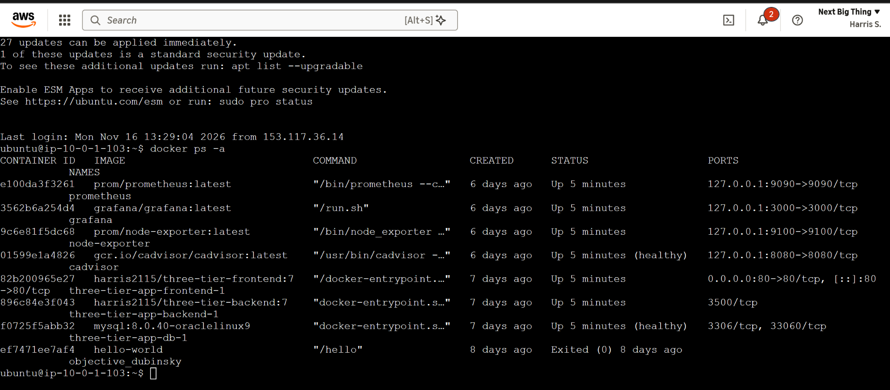

### 14.2 Student Portal verification

The Student Portal was accessed through the EC2 public IP. The student
page displayed existing records and confirmed that a new student record
was added successfully.

Add the Student Portal screenshot at
`assets/screenshots/student-portal-testing.png`.

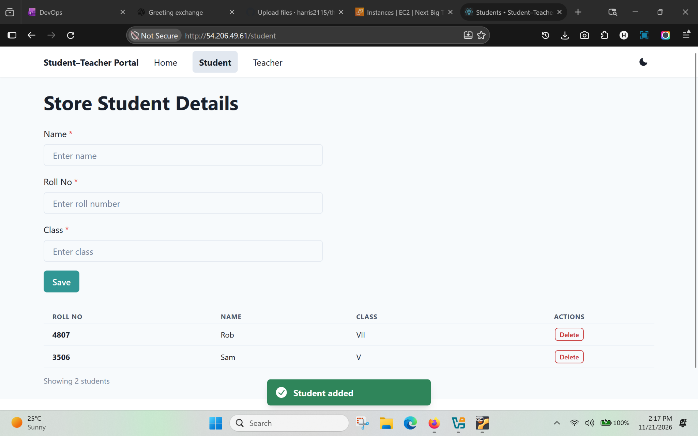

### 14.3 Grafana dashboard verification

The Node Exporter Full dashboard was opened in Grafana to verify
infrastructure metrics, including CPU usage, memory, network traffic,
and disk utilisation.

Add the Grafana dashboard screenshot at
`assets/screenshots/grafana-node-exporter.png`.


### 14.4 Alert verification

The `EC2-High-CPU-Usage` alert rule was checked in Grafana. Its status
was displayed as **Normal**, confirming that the alert rule was active
and being evaluated.

Add the Grafana alert screenshot at
`assets/screenshots/grafana-cpu-alert.png`.

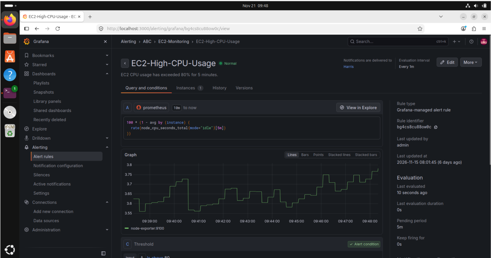

### 14.5 Final result

The final verification confirmed that:

- The Student Portal was accessible on AWS EC2.
- Application containers were running successfully.
- Student records could be added through the application.
- Frontend and backend Docker images were deployed from Docker Hub.
- The Jenkins CI/CD pipeline completed successfully.
- Prometheus and Grafana were running.
- Node Exporter and cAdvisor metrics were available in Grafana.
- The CPU alert rule was configured and displayed a Normal status.

### 14.6 Post-deployment verification and recovery

After updating the Terraform security groups, I performed another
verification pass on **25 November 2026**. The checks covered Terraform
state, SSH access, application health, monitoring endpoints, Docker
restart policies, and recovery after an EC2 reboot.

#### Terraform infrastructure verification

From the Windows Terraform working directory, I ran:

```cmd
terraform fmt
terraform validate
terraform plan
```

Terraform validation succeeded, and the final plan reported:

```text
No changes. Your infrastructure matches the configuration.
```

The preceding Terraform apply updated two security groups in place:

- `frontend_sg`: SSH ingress on TCP port 22 was restricted to the
  administrator's public IP using a `/32` CIDR.
- `backend_sg`: the application ingress rule was corrected from TCP
  port 3000 to TCP port 3500.

The apply completed with **0 added, 2 changed, and 0 destroyed**. The
EC2 instance and the rest of the existing infrastructure were not
recreated.

> **Security note:** The SSH `/32` rule permits access only from the
> public IP configured at the time. If that IP changes, update the
> Terraform configuration and apply the reviewed plan again. Do not
> replace it with `0.0.0.0/0` for convenience.

#### SSH access verification

I connected from Windows Git Bash to the Ubuntu EC2 instance using the
configured private key:

```bash
ssh -i "C:\\Users\\Harris\\.ssh\\three_tier_key" ubuntu@<EC2_PUBLIC_IP>
```

The SSH login succeeded and displayed the Ubuntu server prompt.

#### Application and monitoring health checks

The following checks were run on the EC2 host:

```bash
# Frontend (Nginx)
curl -I http://localhost

# Prometheus
curl -I http://localhost:9090/-/healthy

# Grafana
curl -I http://localhost:3000/api/health

# MySQL container health
docker inspect --format='{{.State.Health.Status}}' three-tier-app-db-1
```

The frontend, Prometheus, and Grafana returned HTTP 200 responses.
MySQL reported `healthy`.

The backend health endpoint was checked from inside its container:

```bash
docker exec three-tier-app-backend-1 node -e "fetch('http://127.0.0.1:3500/health').then(async r => { console.log('HTTP Status:', r.status); console.log(await r.text()); }).catch(e => { console.error(e); process.exit(1); })"
```

It returned HTTP 200 with a JSON response containing
`"status":"ok"` and `"service":"backend"`.

**Why the backend was tested inside its container:** Docker exposes
port 3500 to the application network, but the backend port is not
published on the EC2 host. Therefore, `curl http://localhost:3500`
from the EC2 host is expected to fail with this configuration. The
frontend and backend communicate over the Docker network; the backend
does not need a public host-port mapping.

The backend logs contained earlier MySQL connection-refused messages
during startup. Later log entries confirmed that the backend connected
to MySQL, ensured the `student` and `teacher` tables, and started
listening on port 3500. A subsequent 15-minute log check returned no
new output.

The Student Portal was also opened from a Windows browser using the
EC2 public IP. The frontend loaded and the student and teacher records
were visible.

#### Container restart policy verification

Before rebooting the EC2 instance, I checked the restart policy of
every running container:

```bash
docker inspect -f '{{.Name}} -> {{.HostConfig.RestartPolicy.Name}}' $(docker ps -q)
```

The application containers used `always`, while the monitoring
containers used `unless-stopped`:

| Container | Restart policy |
|---|---|
| Frontend | `always` |
| Backend | `always` |
| MySQL | `always` |
| Prometheus | `unless-stopped` |
| Grafana | `unless-stopped` |
| Node Exporter | `unless-stopped` |
| cAdvisor | `unless-stopped` |

#### EC2 reboot and recovery verification

Ubuntu reported that a system restart was required after updates. After
checking the container restart policies and confirming the application
was working, I restarted the EC2 operating system:

```bash
sudo reboot
```

The SSH session disconnected during the reboot. After the instance
became available again, I reconnected over SSH and checked the Docker
containers with:

```bash
docker ps
```

All seven application and monitoring containers restarted
successfully. I confirmed that the Student Portal was accessible again
after the reboot.

This recovery check verified that the containers' configured restart
policies brought the services back after an EC2 operating-system
restart.

### 14.7 Final result

In addition to the initial deployment tests, the post-deployment
verification confirmed that:

- Terraform's final plan showed no infrastructure drift.
- SSH access worked with the restricted source IP.
- The frontend, backend health endpoint, MySQL, Prometheus, and Grafana
  passed their respective checks.
- The Student Portal remained accessible from a Windows browser.
- All seven containers restarted successfully after the EC2 reboot.

This final pass demonstrates not only deployment and monitoring, but
also infrastructure consistency, controlled SSH access, and container
recovery after a host restart.

The project demonstrated application containerisation, AWS deployment,
CI/CD automation, infrastructure monitoring, and basic operational
recovery.

---

## 🔐 Security Notes

- Never commit `.env` files, passwords, AWS access keys, Docker Hub tokens, or SSH private keys.
- Keep secrets in Jenkins Credentials or an appropriate secrets manager.
- Restrict access to EC2 security-group ports and keep monitoring endpoints private where possible.
- Use HTTPS and dedicated least-privilege database credentials for production deployments.

---

## 👤 Author

**Harris Shakeel**  
DevOps learner | Docker · AWS · Terraform · Jenkins · Prometheus · Grafana

---

## 🔗 Project Repository

[three-tier-devops-project on
GitHub](https://github.com/harris2115/three-tier-devops-project)
